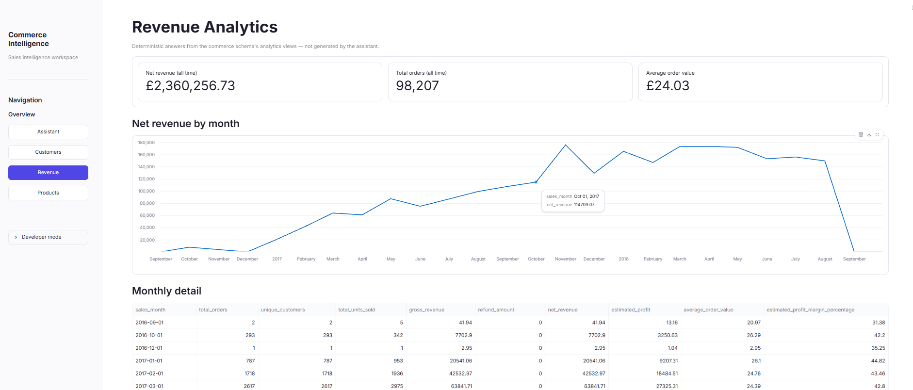
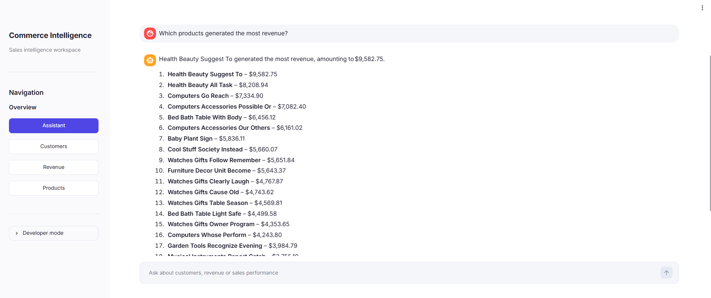
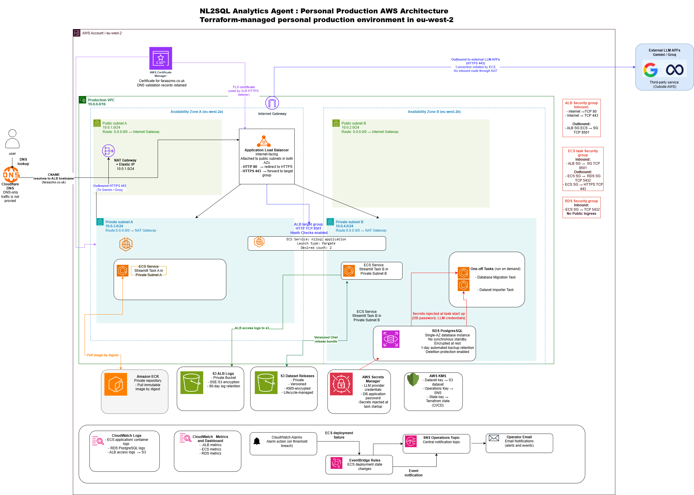

# NL2SQL Analytics Agent

[](https://github.com/23faraaz/NL2SQL-Analytics-Agent/actions/workflows/ci.yml)
[](terraform/)
[](docs/production-architecture-decisions.md)
[](.github/workflows/ci.yml)

A personal production analytics platform on AWS. Users ask business questions
in plain English; the application generates SQL, rejects unsafe statements,
executes approved read-only queries against PostgreSQL, and returns charts and
plain-English results over the Olist e-commerce dataset.

The application matters, but the main engineering focus is the delivery and
operating model: Terraform-managed infrastructure, private workloads,
short-lived AWS credentials, immutable container promotion, deployment
rollback, database recovery, observable failure modes, and repeatable imports.

> `faraazmo.co.uk` is available when the cost-controlled environment is running.
> This is personal production—not a business-critical service or contractual SLA.

## Engineering highlights

| Capability | Implementation |
|---|---|
| Infrastructure as code | Reusable Terraform modules with separate bootstrap, global, staging, and production roots |
| Network isolation | Public ALB; ECS tasks and RDS in private subnets; security-group-to-security-group access |
| Trusted delivery | GitHub OIDC, least-privilege IAM roles, immutable ECR digests, and protected production approval |
| Release safety | Trivy gates, ECS stabilization, target-health checks, HTTPS smoke tests, and automatic rollback |
| Data operations | Versioned KMS-encrypted S3 releases, one-off Fargate importer, SHA-256 verification, and import ledger |
| Recovery and operations | Tested RDS point-in-time restore, nine CloudWatch alarms, EventBridge, SNS, and budget alerts |
| Local reproducibility | Docker Compose with idempotent database initialization tested across repeated starts |

## Product preview

The production application combines deterministic commerce dashboards with a
guarded natural-language analytics assistant.

### Revenue analytics



### Natural-language analytics assistant



## Architecture

[](docs/architecture/aws-production-architecture.drawio.png)

The editable draw.io model is embedded in the tracked PNG. The VPC spans two
Availability Zones in `eu-west-2`; the ALB is attached to both public subnets,
while Fargate tasks and RDS have no public IPs. Traffic is restricted to
`Internet → ALB:443 → ECS:8501 → RDS:5432`. One NAT Gateway provides private
task egress to AWS APIs and Gemini/Groq.

Runtime, data, and control paths are deliberately separated:

- **Runtime:** Cloudflare DNS → ACM-backed ALB → two Streamlit Fargate tasks → RDS.
- **Data:** versioned S3 release → one-off importer task → validated, idempotent RDS load.
- **Delivery:** GitHub Actions → OIDC/IAM → ECR digest → approved ECS deployment.
- **Operations:** ALB/ECS/RDS telemetry → CloudWatch/EventBridge → SNS → operator.

## Delivery and security model

```text
Pull request
  ├─ lint and formatting ─────────────────────┐
  ├─ unit tests: Python 3.11 + 3.12 (matrix) ├─ parallel CI jobs
  ├─ repeated-Compose initialization test ───────┤
  └─ Terraform validation and security scan ───────┘
                         │
                         ▼
              build app + importer images
                         │
                         ▼
              Trivy HIGH/CRITICAL gates
                         │
                         ▼
        main only: publish exact scanned images
                to ECR by commit SHA/digest
                         │
                         ▼
              protected production approval
                         │
                         ▼
                 deploy to ECS Fargate
                         │
                         ▼
        stabilization + ALB health + HTTPS smoke test
                  ├─ healthy: release
                  └─ unhealthy: rollback
```

The Python 3.11/3.12 matrix and independent lint, Compose, Terraform, and image
jobs run in parallel for fast feedback. Workflow concurrency cancels superseded
runs so an older release cannot overtake a newer commit. Pull requests have
read-only repository permissions and cannot request AWS credentials; only a
successful `main` run can exchange GitHub's OIDC token for short-lived,
least-privilege AWS credentials.

CI builds and scans the application and importer once, then transfers those
exact artifacts to the trusted publishing job. ECR records immutable commit
tags and content digests, while CD verifies the CI metadata and deploys the
digest-qualified image instead of rebuilding it. The protected `production`
environment supplies the manual approval boundary. Application CD cannot
modify the VPC, RDS, broad IAM policy, or its own trust relationship, and ECS
stabilization, target health, and HTTPS checks drive rollback on failure.

Secrets come from Secrets Manager; runtime dependency graphs are hash-locked;
generated SQL is limited by an AST-based read-only validator and database
statement timeout. The implementation is in [CI](.github/workflows/ci.yml),
[application CD](.github/workflows/cd.yml), and the detailed
[CI/CD trust model](docs/ci-cd.md).

## Evidence, not just configuration

| Exercise | Result |
|---|---|
| Immutable release | [CI run 38682770353](https://github.com/23faraaz/NL2SQL-Analytics-Agent/actions/runs/38682770353) published the scanned digests; [CD run 38683221055](https://github.com/23faraaz/NL2SQL-Analytics-Agent/actions/runs/38683221055) passed ECS, ALB, and HTTPS gates |
| Rollback | A deliberately unhealthy revision failed repeatedly and ECS returned to the last healthy task definition while the public endpoint remained available |
| Restore | RDS point-in-time recovery was validated against expected production row counts; the temporary instance was then removed |
| Import idempotency | The same immutable S3 bundle was imported twice without changing row counts |
| Alert delivery | A controlled CloudWatch alarm reached the confirmed SNS subscription and was restored to `OK` |
| Local lifecycle | CI starts the same Compose database twice against one volume and asserts that duplicate data is not created |

The complete audit trail is in [EXECUTION_PLAN.md](docs/EXECUTION_PLAN.md).

## Deliberate trade-offs

| Decision | Accepted consequence |
|---|---|
| Single-AZ RDS | Database maintenance or an AZ failure can interrupt the whole service |
| One NAT Gateway | Lower complexity, but one AZ-level outbound dependency and possible cross-AZ charges |
| One-day backup retention | Meets the accepted 24-hour RPO but gives little recovery history |
| Personal email ownership | Appropriate for one operator, not equivalent to an on-call rotation |
| Best-effort 99% objective | No contractual SLA; operator-attended four-hour RTO target |
| USD 20 warning | Alert only—the continuously running stack is estimated at USD 130–160/month before VAT |

This is intentionally a production-shaped learning environment, not the
cheapest hosting design. Snapshot preservation and safe teardown are documented
in the [cost handoff](docs/PORTFOLIO_COST_HANDOFF.md).

## Run locally

Requirements: Docker Compose, an API key/model for Gemini or Groq, and the
[Olist dataset](data/raw/README.md) under `data/raw/`.

```bash
cp .env.example .env
# Set DB_PASSWORD and the selected provider credentials.
docker compose up --build
```

Compose waits for PostgreSQL, runs ETL and seeded augmentation, loads the
commerce schema, then serves Streamlit at `http://localhost:8501`. Repeated
starts become a verified no-op when persisted tables match the processed files;
partial or inconsistent state is rejected rather than overwritten.

### Quality gates

```bash
python -m pip install --require-hashes -r requirements-dev.txt
ruff check .
black --check .
pytest -m "not integration" --strict-markers

# Uses an isolated PostgreSQL volume and runs initialization twice.
DB_NAME=nl2sql_compose_regression \
DB_USER=nl2sql_test \
DB_PASSWORD=compose-regression-only \
bash tests/integration/compose-repeated-up.sh
```

## Repository guide

| Path | Responsibility |
|---|---|
| `app/`, `etl/`, `sql/` | Application, deterministic data pipeline, schema, views, and migrations |
| `terraform/` | Bootstrap, global, staging, production, and reusable AWS modules |
| `.github/workflows/` | CI, immutable application CD, infrastructure plan/apply, and dataset import |
| `tests/` | Unit, database integration, regression, and Compose lifecycle tests |
| `docs/` | Decisions, security model, runbooks, cost posture, and operational evidence |

## Deep dives

- [Architecture decisions](docs/production-architecture-decisions.md) · [CI/CD trust](docs/ci-cd.md) · [SQL safety](docs/security.md)
- [Production runbook](docs/production-runbook.md) · [Operations checklist](docs/PRODUCTION_OPERATIONS_CHECKLIST.md) · [Troubleshooting](docs/troubleshooting.md)
- [Execution evidence](docs/EXECUTION_PLAN.md) · [Cost/teardown](docs/PORTFOLIO_COST_HANDOFF.md) · [Data provenance](docs/data_mapping.md)
